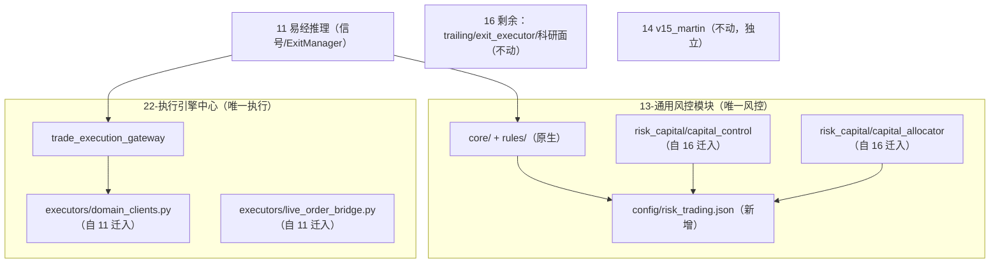

# SPEC-2026-11-14 · 13/16 风控整合与 22 执行器收口

| 项 | 内容 |
|---|---|
| 版本 | v1.0 |
| 状态 | 已确认，待执行 |
| 决策日期 | 2026-11-14 |
| 决策来源 | 用户确认（见认知记忆 `VM-1794585931057-cb920cac`） |
| 前置审计 | [架构审计 2026-11-13]（13/16/22 冲突清单 P0×2、P1×4、P2×3） |

---

## 1. 背景与已核实事实

1. **13 闸门空转（P0）**：22 `TradeExecutionGateway` 构造裸 `PreTradeGate()`（trade_execution_gateway.py L466-467），从不调用 `register_default_gate_rules`；运行时 `gate.registry` 规则数=0，`check()` 恒返回 pass。
2. **16 资金模型双轨**：`capital_control`（账户级 USDT 预算，被 11 调用）与 `capital_allocator`（币种级 Kelly/层级/扩展，被 22 Gateway 调用）串行缩仓，口径不同且无 SSOT。
3. **16 已依赖 13**：`capital_control/component.py` 与 4 个 `capital_rules/*.py` 均通过 `_RISK_DIR` 引用 13 → 合并方向 16→13 天然成立。
4. **11 执行器可迁出**：`_DomainTaggedOkxClient`（L650-760）、`_DomainRoutedOkxClient`（L761-860）、装配段（L1180-1290）、`live_order_bridge.py` 与 13/16 无耦合。
5. **14 classic 死代码已核实**：`ClassicExitSystem` 仅 L1538 构造、`evaluate_*` 零调用；"震荡市放宽止损"只改该死对象 config（L19505-19519），实际生效的 `TrailingStopStrategy` 硬编码 0.015。
6. **用户边界**：14 域**完全不动**（独立运行，v15_martin 仍活跃）；A9 属 AI SKILL 建议面；23 EvolutionExit 属 23 专用。

## 2. 目标与非目标

### 2.1 目标
- **G1（P0）**：13 门禁立即真实生效（fail-closed），不设 shadow 观察期。
- **G2**：16 的**风控相关子包**迁入 13，形成唯一风控模块（保留 `13-通用风控模块` 目录名）。
- **G3**：11 的执行器代码迁入 22，22 成为唯一执行入口，11 只保留信号与决策。
- **G4**：16 剩余可并入部分（`param_center`）并入 `4-MEMORY/9-工具与接口`；科研面暂留 16。
- **G5**：全过程旧路径可导入（shim），launchd / systemd / MCP 入口不改名。

### 2.2 非目标（本轮不做）
- 不迁 16 `trailing_stop` / `exit_executor` / `unified_position_query`（离场链保持现状，14 不动）。
- 不迁 16 的 `a1/a2/a3` adapters、`a9_exit_decision`、`auto_exit_system`、`llm_*`、`evolution_*`、`backtest_*`。
- 不删除 14 任何目录与文件；不删除 `classic_exit_system.py`（本轮仅记录缺陷，删除列入后续 P3）。
- 不改变 23 的 `_DomainTaggedOkxClient` 行为（仅迁位置）。
- 不改 11 的 `polling_trader_watch.sh` / launchd 名称。

## 3. 目标架构

依赖方向：`11 → 22 → 13`、`16(残余) → 13`、`16(残余) → 14`。**禁止反向 import**。

## 4. 模块映射

| # | 源 | 目标 | 方式 |
|---|---|---|---|
| M1 | `16-调控系统/core/capital_control/` | `13-通用风控模块/risk_capital/capital_control/` | git mv + 调整 `_RISK_DIR` |
| M2 | `16-调控系统/core/capital_allocator/` | `13-通用风控模块/risk_capital/capital_allocator/` | git mv |
| M3 | `11-.../polling_trader.py` L650-760 `_DomainTaggedOkxClient` | `22-执行引擎中心/executors/domain_clients.py` | 抽类迁移 + 11 侧别名 |
| M4 | `11-.../polling_trader.py` L761-860 `_DomainRoutedOkxClient` | 同上 | 同上 |
| M5 | `11-.../live_order_bridge.py` | `22-执行引擎中心/executors/live_order_bridge.py` | git mv + shim |
| M6 | `16-调控系统/scripts/param_center/` | `4-MEMORY/9-工具与接口/param_center/` | P3 执行，需同步 11 的 sys.path |
| M7 | 旧路径 `16-调控系统/core/capital_*` | 保留为 1 行 re-export shim | 兼容 16 内部与 11 现有 import |

## 5. 详细设计

### 5.1 P0：13 门禁生效

1. 13 新增 `core/factory.py`：
   - `create_gate(config: dict | None = None) -> PreTradeGate`：内部 `RuleRegistry()` + `register_default_gate_rules(registry, config)`，返回带规则的门禁。
   - `create_risk_engine(config)` 同步注册 gate/position/exit 默认规则。
   - 配置来源 `13-通用风控模块/config/risk_trading.json`；缺文件时用代码默认值（并落 WARN 日志），**任何异常都 fail-closed**。
2. 22 `_load_13_modules` 改为加载 `create_gate`，Gateway `submit` 使用带规则门禁。
3. 审计增强：`gateway.jsonl` 记录 `rules_evaluated`、`rule_name`、`reason_code`；`position_modifier` 来自真实规则。
4. 立即生效：不做 shadow；上线后首个交易窗口观察 `RISK_REJECT` 比例。

### 5.2 16 → 13 迁移

- `git mv` 两个子包到 `13/risk_capital/`，保留包名。
- `_RISK_DIR` 计算改为：优先 `13` 根（`parents[2]`），并对旧路径 `parents[3]` 失效做兜底。
- shim：`16-调控系统/core/capital_control/__init__.py`、`capital_allocator/__init__.py` 改为从 `risk_capital.*` 转发；`component.py`/`types.py` 被外部直接 import 的模块保留 1 行转发文件。
- 11 无需改 import（shim 生效）；P2 再切到 `risk_capital` 直连。

### 5.3 11 → 22 执行器迁移

- 新建 `22-执行引擎中心/executors/`：
  - `domain_clients.py`：`DomainTaggedOkxClient`、`DomainRoutedOkxClient`（去掉下划线，保留旧别名）。
  - `live_order_bridge.py`：迁入后检查其依赖，若含 11 内部模块，改为**回调注入**，禁止 22 import 11。
- 11 侧：删除类实现，改为 `from executors.domain_clients import ... as _DomainTaggedOkxClient`；保留 `_DomainRoutedOkxClient` 同名别名，装配逻辑不动。
- 验收后 `polling_trader.py` 预计减少约 500–700 行。

### 5.4 16 剩余处置

- `param_center`：被 11 在 SL/TP 读取中多处使用（L8636-8647、L10068、L12142、L12869），迁移需同步 11 的 sys.path 与 import 前缀 → **P3 单独执行**。
- 科研/AI 面（a1-a3、a9、llm_*、evolution_*、backtest_*）：暂留 16，不强行搬 4-MEMORY（无明确记忆语义，依赖复杂）。

### 5.5 边界确认

- 14：零改动。16 的 trailing/exit_executor 继续使用 14/lib 客户端，独立运行。
- A9：`a9_exit_decision` + adapters 仅作只读建议，不进入统一执行链。
- 23：仅迁客户端位置，行为不变（raw + evo23 tag + shadow）。

## 6. 兼容与回滚

- 所有迁移保留旧路径 shim 至少一个迭代周期。
- 每阶段独立 commit；回滚 = revert 该 commit + 恢复 shim 转发。
- 迁移前记录基线：`gateway.jsonl` 最近 500 条 reason 分布、trailing runner pid/日志、11 启动日志。

## 7. 验收门禁（TDD）

| ID | 测试 | 断言 |
|---|---|---|
| T-G1a | `13/tests/test_gate_factory.py` | `create_gate()` 规则数 ≥ 7；启用项与配置一致 |
| T-G1b | `22/tests/test_gateway_gate_active.py` | 违反杠杆/回撤约束的信号被拒，reason_code 正确 |
| T-G1c | 审计冒烟 | gateway.jsonl 新增 `rules_evaluated>0` |
| T-G2a | `13/tests/test_risk_capital_import.py` | 新路径可 import；旧 shim 等价 |
| T-G2b | 16 原有 capital 测试 | 全绿（不允许改断言） |
| T-G3a | `22/tests/test_domain_clients_moved.py` | 22 可独立 import；11 别名等价；无 22→11 import |
| T-G3b | 11 冒烟 | `python -c "import polling_trader"` + 启动日志无 ImportError |
| T-G4 | `4-MEMORY` param_center 测试 + 11 冒烟 | 参数读取结果与迁移前逐值一致 |
| T-REG | 全量回归 | 11/13/16/22 相关 pytest 全绿 |

## 8. 任务拆解

| 任务 | 内容 | 依赖 |
|---|---|---|
| T1 | 基线记录 + 分支 | — |
| T2 | RED：T-G1a/T-G1b 测试 | T1 |
| T3 | GREEN：13 `core/factory.py` + config + 22 接入 | T2 |
| T4 | RED/GREEN：T-G2a/T-G2b，迁移 M1/M2 + shim | T3 |
| T5 | RED/GREEN：T-G3a/T-G3b，迁移 M3/M4/M5 | T4 |
| T6 | 回归 + 11 启动冒烟 + trailing runner 冒烟 | T5 |
| T7 | 16 剩余评估结论落文档（param_center 处置） | T6 |
| T8 | 文档索引同步 + 认知回写 | T7 |

## 9. 风险与缓解

| 风险 | 缓解 |
|---|---|
| 门禁立即生效导致拒单 | 先用当前配置跑离线回放（近 7 天信号）验证拒绝率；异常一键回退 T3 commit |
| `core` 包名争用 | 新模块统一 `risk_capital.*` 前缀；13 内部仍用相对导入 |
| shim 循环导入 | shim 只做 `from ... import *`，不反向依赖 16 |
| 22 import 11 成环 | 迁移前 grep 校验；bridge 改回调注入 |
| 14 受影响 | 本轮零改动，回归仅做只读冒烟 |

## 10. 执行记录

### T1–T3（P0 门禁生效）✅ 2026-11-14

- 新增 `13-通用风控模块/core/factory.py`（`create_gate` / `create_risk_engine` / `load_risk_config`），规则数=0 直接抛 `RuntimeError`（fail-closed）。
- 新增 `13-通用风控模块/config/risk_trading.json`，gate 段为 `{rule_name: params}` 两级结构（与 `PreTradeGate` 的取值方式一致）。
- `13/core/pre_trade_gate.py` 在 `RiskCheckResult.details` 中回填 `rules_evaluated` / `rule_name`。
- `22/trade_execution_gateway.py`：`_create_gate()` → `core.factory.create_gate`；加载失败 fail-closed（开仓拒 / 平仓放行）；审计新增 `rules_evaluated`、`rule_name`。
- 离线回放近 500 条审计：370 条开仓信号中仅 `source=test`、`confidence=0` 的 20 条会被拒，生产信号无额外拒绝。
- 测试：`13/tests/test_gate_factory.py`（11 项）、`22/tests/test_gateway_gate_active.py`（3 项）全绿；22 既有 gateway/shadow 测试无回归。

### T4（16 → 13 资金子包迁移）✅ 2026-11-14

- `git mv` 两个子包 → `13-通用风控模块/risk_capital/{capital_control,capital_allocator}`。
- 路径修正：`capital_control/component.py`、`capital_rules/*.py`、`capital_allocator/component.py` 的 repo/13 根与 16 配置目录定位。
- 旧路径 shim：`16-调控系统/core/{capital_control,capital_allocator}/__init__.py` +
  `16/core/_risk_capital_shim.py`（MetaPathFinder 别名，保证子模块与类对象同一性，
  避免 `isinstance` 失效）。配置与 `unified_position_query` 仍留在 16（本轮不迁）。
- 测试：`13/tests/test_risk_capital_import.py`（4 项）全绿；`16/tests/capital_*` 除 3 项
  **既有**失败外全绿；11 `test_capital_control_integration.py` 13 项全绿；
  `PYTHONPATH=11-易经推理系统 python -c "import scripts.memory_l4.polling_trader"` 通过。

已知既有失败（与本次迁移无关，mock 仍按旧 `extra` 嵌套结构构造 / 配置与断言漂移）：

| 测试 | 原因 |
|---|---|
| `test_unit.py::test_build_result_dynamic_with_equity` | mock 把 `avail_balance/used_margin` 放在 `extra` 内，真实 `_make_system_result` 已扁平化 |
| `test_integration.py::test_phase2_advice_blocks_raise_tp` | 同上（used_pct 读不到 → 压力 LOW） |
| `test_e2e.py::test_config_json_valid` | `config/capital_control.json` 的 `phase2.enabled` 已为 true，断言仍期望 false |

