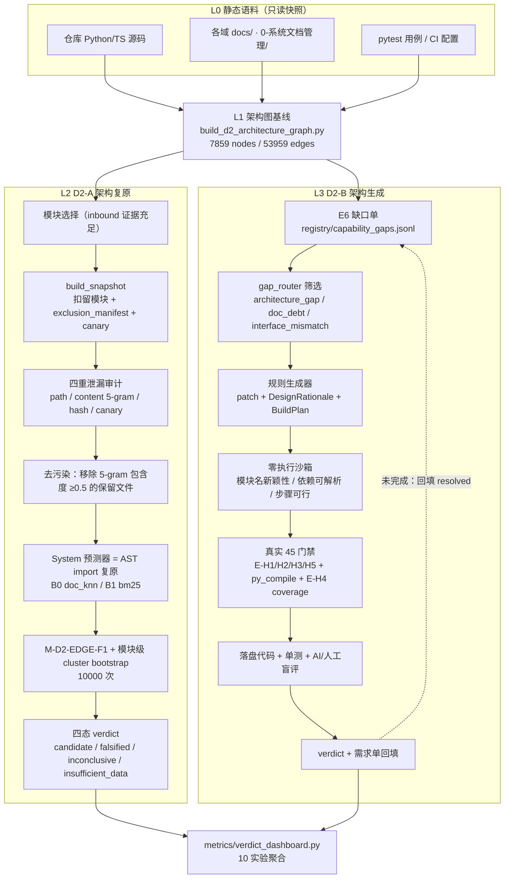
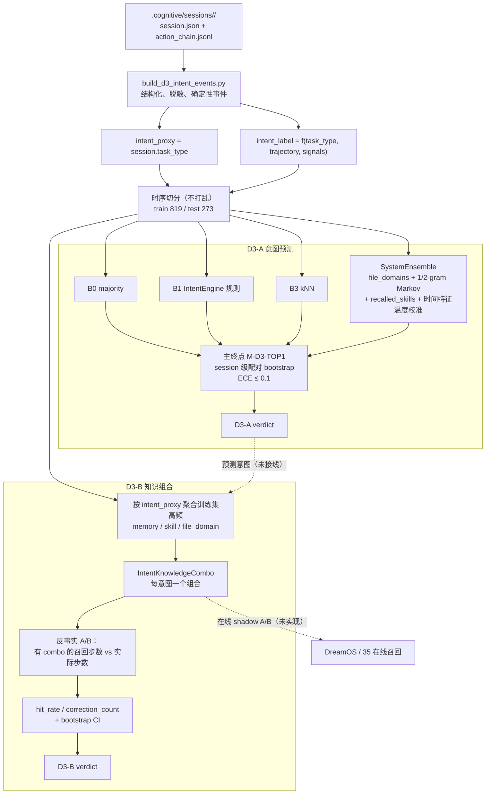

# SPEC — D2 技术架构涌现 / D3 意图涌现 双链路技术文档 v0.1

> 🧭 **特别标识：D2-D3-CHAIN-SSOT**
> 本文件是 48-涌现架构对 **D2 技术架构涌现** 与 **D3 意图涌现** 两条链路的唯一技术文档。
> D1 交易涌现链路见 [SPEC-EMERGENCE-FULL-CHAIN-v1.0.md](./SPEC-EMERGENCE-FULL-CHAIN-v1.0.md)（FULL-CHAIN-SSOT）；本文件不重复 D1，只做三链差异对照。
>
> **版本**：v0.1（2026-11-11）
> **状态**：🟢 双链路代码核查完成；四个子实验均已 formal 落盘，X-A 为代理实验（真实联合 A/B 已 deferred）
> **定义源**：[SPEC-EMERGENCE-3D-v0.1.md](./SPEC-EMERGENCE-3D-v0.1.md)（判据/统计/状态机口径不在此重复）；本文件只描述**实现链路、数据流、契约、产物与真实状态**
> **上游**：3D 子 Spec · 33-REA 逆向解析 · 45-评测系统 · 0-系统文档管理 · DreamOS · 35-广义认知 · 47-MCP
> **状态图例**：✅ 已实现且有 formal 产物/测试 ｜ 🟡 部分实现或为代理口径 ｜ ⬜ 仅协议/未实现
> **边界**：48 只做判据、实验、度量与观测；D2 生成器归 33-REA/46-DSH，D3 归 DreamOS/35；生成物零执行权。

---

## §0 摘要

1. **D2 与 D3 不是同一条链路的两个指标，而是两种完全不同的涌现载体**：D2 在**离线静态证据**上做架构复原/生成（真值是 AST 结构与工程门禁），D3 在**在线行为序列**上做意图预测/知识组合（真值是会话标签与用户接受）。
2. **D2-A 已 formal 产出 `candidate`**：5 个 holdout 模块、230 条 GT import 边 100% 自动核验、系统 F1=1.0、模块级 95% CI 0.957..1.0。但系统预测器是 **AST import 复原器**，且 prereg 要求的人工盲评**尚未执行**——当前只能称"统计候选"。
3. **D2-B 已形成"缺口→方案→沙箱→真实 45 门禁→落盘代码→AI 盲评"完整闭环**：3/3 candidate，`gate_mode=real_45_local`，E-H4 覆盖率实测 0.9767；生成模块已真实落入 33-REA 与 0-系统文档管理。但 E6 需求单仍未回填 `resolved`，且 originality 均值仅 1.0/2。
4. **D3-A/D3-B 均 formal 产出 `candidate`**：D3-A TOP1 0.908 vs 规则基线 0.886（+2.2pp，CI 0.004..0.044，ECE 0.066）；D3-B 召回步数 8.10→1.0（CI 7.02..7.19，命中率 0.588）。但 D3-A 的预测目标是 `task_type` 代理标签，D3-B 是离线反事实，**均未接在线 A/B**。
5. **X-A 当前只是代理实验**：`G_123=0.080`（CI 0.023..0.136）、`Ω=0.060`，由三个异构实验的增益拼接而成；真实联合 A/B（`XA-REAL-3f28d4b1543f`）因 `insufficient_pairs` 已 **deferred**。因此**不得**据此宣称"三维涌现"，只能称"跨域联合收益（代理）"。

---

## §1 两条链路为什么不同

| 维度 | D2 技术架构涌现 | D3 意图涌现 |
|---|---|---|
| **问题** | 扣留代码/文档后，能否从剩余证据复原架构；能否提出人未写过且可落地的工程方案 | 能否从历史会话/习惯/错误案例预测下一个意图；能否组装知识组合缩短到达正确动作的路径 |
| **数据形态** | 仓库静态语料（源码、docs、测试、CI），版本固定快照 | 运行时会话流（`.cognitive/sessions`），按时间切分 |
| **真值来源** | AST/import 边（结构真值）+ 45 工程门禁 + 人工盲评 | 会话 `task_type` 代理标签 + （尚未采集的）用户接受/修改/拒绝 |
| **统计单元** | 模块（D2-A n=5；D2-B n=3 缺口） | 会话（D3-A/D3-B n=273 test sessions） |
| **主终点** | `M-D2-EDGE-F1` / `M-D2-ENG-GATE-PASS` | `M-D3-TOP1` / `M-D3B-RECALL-STEP-DELTA` |
| **生成物** | `ArchitectureGraph` patch + `DesignRationale` + `BuildPlan` + 代码骨架 | `IntentKnowledgeCombo`（memory/SKILL/doc 组合） |
| **执行权** | 零执行权；仅沙箱编译 + 45 门禁；人工审后合入 | 只影响召回/组装，不直接执行动作 |
| **反馈闭环** | E6 缺口单 → 方案 → 门禁 → 落盘 → 回填 `resolved` | 预测 → 组合 → 在线接受率/纠正率 → 更新先验（未接） |
| **主要风险** | 结构真值可被文本线索直接复原，指标虚高；生成物 originality 低 | 单用户、标签代理、隐私、离线反事实不等于真实收益 |
| **归属** | 33-REA / 45 / 0-系统文档管理 / 46-DSH | DreamOS / 35 / 47 |

**一句话**：D2 是"**结构证据的可复原性与可生成性**"，D3 是"**行为序列的可预测性与可组合性**"。两者的数据源、真值、统计单元和失败代价都不同，不能共用同一套实验执行器，只能共用判据矩阵（E1-E5）与统一度量 schema。

---

## §2 D2 技术架构涌现链路

### 2.1 端到端数据流



### 2.2 L0-L1：静态语料与架构图基线 ✅

| 项 | 内容 |
|---|---|
| 语料 | 全仓 Python 源码、各域 `docs/`、`0-系统文档管理/`、pytest/CI |
| 构建器 | [build_d2_architecture_graph.py](file:///Users/zhangjiangtao/WorkBuddy/dreambuddy-v2/48-涌现架构/baselines/build_d2_architecture_graph.py) |
| 产物 | [architecture_graph.json](file:///Users/zhangjiangtao/WorkBuddy/dreambuddy-v2/48-涌现架构/baselines/artifacts/d2_architecture_graph/architecture_graph.json)（7859 nodes / 53959 edges） |
| 边类型 | `import` / `call` / `data_flow` / `contract` / `doc_ref`；D2-A 的 GT 只取 **import** 边 |
| 已知缺陷 | `call` 边为函数名级解析（重名取路径首个），实测 27563 条 call 边存在大量假依赖，已开 [GAP-20261109-3cde51c5](file:///Users/zhangjiangtao/WorkBuddy/dreambuddy-v2/48-涌现架构/registry/capability_gaps.jsonl) |
| 适配器缺口 | 当前只覆盖 Python；TypeScript 前端未进图 ⬜ |

### 2.3 L2 D2-A：架构复原 holdout ✅（statistical candidate）

**实验器**：[run_d2a.py](file:///Users/zhangjiangtao/WorkBuddy/dreambuddy-v2/48-涌现架构/experiments/d2a_holdout/run_d2a.py) · [holdout.py](file:///Users/zhangjiangtao/WorkBuddy/dreambuddy-v2/48-涌现架构/experiments/d2a_holdout/holdout.py) · [leak_audit.py](file:///Users/zhangjiangtao/WorkBuddy/dreambuddy-v2/48-涌现架构/experiments/d2a_holdout/leak_audit.py) · [evaluate.py](file:///Users/zhangjiangtao/WorkBuddy/dreambuddy-v2/48-涌现架构/experiments/d2a_holdout/evaluate.py) · [baselines.py](file:///Users/zhangjiangtao/WorkBuddy/dreambuddy-v2/48-涌现架构/experiments/d2a_holdout/baselines.py)
**系统预测器**：[review/system_predictor_d2a.py](file:///Users/zhangjiangtao/WorkBuddy/dreambuddy-v2/48-涌现架构/review/system_predictor_d2a.py)（stdin=快照 JSON，stdout=JSONL 边）

**流水线**：

1. 从架构图选 inbound 证据充足、可扣留的模块（默认 5 个）；
2. `build_snapshot` 扣留模块文件，生成 `exclusion_manifest.json` 与每模块唯一 canary；
3. **四重泄漏审计**：路径、内容 5-gram 包含度（阈值 0.5）、hash 重复、canary 泄漏；
4. 去污染：移除与扣留文件 5-gram 包含度 ≥0.5 的保留文件（真实重复副本 / 内嵌源码文档）；
5. System 预测器对保留文件做 AST import 解析，映射回仓内路径，输出落在扣留模块前缀下的边；
6. 与 GT import 边比对，计算模块级 F1；对模块做 10000 次 cluster bootstrap；
7. 四态判定（`candidate` 需 CI 下界 >0；原 prereg 还要求盲评 ≥4/5）。

**正式运行** `D2A-ba929d3fac60`（2026-11-10，formal）：

| 模块 | 扣留文件 | GT 边 | 泄漏审计 | 去污染文件 | System F1 | 最佳基线 F1 |
|---|---:|---:|---|---:|---:|---:|
| `11-易经推理系统/scripts` | 474 | 119 | clean | 12 | 1.000 | 0.000 |
| `1-ARCHITECTURE/dreamos` | 759 | 83 | clean | 1 | 1.000 | 0.000 |
| `14-V15经典马丁策略` | 15 | 13 | clean | 0 | 1.000 | 0.071 |
| `12-三屏趋势系统/ml` | 155 | 11 | clean | 4 | 1.000 | 0.000 |
| `9-基本面分析/ops` | 64 | 4 | clean | 2 | 1.000 | 0.000 |
| **合计** | — | **230** | **全 clean** | **19** | **1.000** | **0.071** |

- GT 边自动核验：**230/230 通过（100%）**，见 [manual_review.md](file:///Users/zhangjiangtao/WorkBuddy/dreambuddy-v2/48-涌现架构/experiments/d2a_holdout/results/D2A-ba929d3fac60/manual_review.md)；
- 模块级 95% CI：**0.957..1.0**（n_modules=5，10000 次，seed=42）；
- 判定：`candidate`（主终点 CI 下界 >0）。

**必须同时读的限制**（[limitation.md](file:///Users/zhangjiangtao/WorkBuddy/dreambuddy-v2/48-涌现架构/experiments/d2a_holdout/results/D2A-ba929d3fac60/limitation.md)）：

1. **这不是"语义理解"**：保留文件仍含对这些模块的 `import` 语句，AST 直接可复原；B0/B1 是不解析语法的检索基线，因此 1.0 vs 0 的差距主要证明"语法线索可用"，不等于架构设计能力。
2. **人工盲评未执行**：`manual_review.md` 的"人工盲评 ≥4/5"与"formal run 产出 candidate"两项仍是未勾选状态；按 prereg 严格口径，当前应视为 **统计候选、待人工复核**。
3. **GT 仅 import 边**：call/data_flow/contract 边未进入本次主终点。
4. **模块级样本太小**：n_modules=5，CI 宽度由模块数决定，不能外推到全仓。

### 2.4 L3 D2-B：架构生成 ✅（3/3 candidate，AI 盲评 verified）

**实验器**：[run_d2b.py](file:///Users/zhangjiangtao/WorkBuddy/dreambuddy-v2/48-涌现架构/experiments/d2b_engineering/run_d2b.py) · [generator.py](file:///Users/zhangjiangtao/WorkBuddy/dreambuddy-v2/48-涌现架构/experiments/d2b_engineering/generator.py) · [sandbox.py](file:///Users/zhangjiangtao/WorkBuddy/dreambuddy-v2/48-涌现架构/experiments/d2b_engineering/sandbox.py) · [gate_45.py](file:///Users/zhangjiangtao/WorkBuddy/dreambuddy-v2/48-涌现架构/experiments/d2b_engineering/gate_45.py)

**流水线**：

```
capability_gaps.jsonl
  → gap_router 取 D2-B 类缺口（architecture_gap / doc_debt / interface_mismatch）
  → generator 产出 { ArchitectureGraph patch, DesignRationale, BuildPlan, code_skeleton }
  → sandbox 零执行校验（模块名新颖性 / 依赖可解析 / 步骤可行性）
  → gate_45 真实门禁（本地）
  → 落盘代码 + 单测 + 盲评
  → verdict 聚合
```

**真实 45 门禁口径（`gate_mode=real_45_local`）**：

| 门禁项 | 实现 | 结果 |
|---|---|---|
| E-H1 秘密扫描 | 本地规则扫描 | PASS，`secret_hits=[]` |
| E-H2 依赖漏洞 | `pip-audit`（stdlib-only 模块直接判无供应链面） | PASS，`vuln_count=0` |
| E-H3 可追溯 | 本地 attestation，commit `ed454e2c06` | PASS |
| E-H5 旁路检测 | 本地规则扫描 | PASS，`bypass_hits=[]` |
| 语法 | `py_compile` | PASS |
| E-H4 覆盖率 | 真实测量 | PASS，`coverage_rate=0.9767` |
| E-W5 / E-W6 | pycg 基准集 / OpenSSF Scorecard | **deferred**（需 CI 环境/网络） |

**正式运行** `D2B-85719d4f2ca4`（formal）：

| 缺口类型 | 生成模块 | 沙箱 | 45 门禁 | verdict |
|---|---|---|---|---|
| `architecture_gap` | `33-REA逆向解析工程/ast_call_resolver.py` | 过 | real_45_local 全过 | candidate |
| `doc_debt` | `0-系统文档管理/doc_coverage_checker.py` | 过 | real_45_local 全过 | candidate |
| `interface_mismatch` | `33-REA逆向解析工程/interface_signature_extractor.py` | 过 | real_45_local 全过 | candidate |
| **overall** | — | — | — | **candidate（3/3）** |

**落盘与盲评**：

- 三个生成模块已于 2026-11-10 真实落入仓库；配套 [test_d2b_modules.py](file:///Users/zhangjiangtao/WorkBuddy/dreambuddy-v2/48-涌现架构/tests/test_d2b_modules.py)；
- 盲评 [report.json](file:///Users/zhangjiangtao/WorkBuddy/dreambuddy-v2/48-涌现架构/experiments/d2b_engineering/blind_review/report.json)：4 文件、15/15 pytest、均分 **7.75/10**、`verdict=verified`；
- **但 reviewer 是 `AI-reviewer (trae-agent, authorized substitute for independent human)`**：可作过渡，不满足"独立人工盲评"的最终口径；且 `originality` 轴均分仅 **1.0/2**，说明方案主要是模板重组，E2 的"人未写过"仅结构性成立。

**闭环缺口**：3 条 11-09 缺口在 `capability_gaps.jsonl` 中仍为 `status=open`，未写 `resolved` / `resolution_note`；11-10 新增的 34 条 D2 类缺口（10 architecture_gap / 12 doc_debt / 12 interface_mismatch）尚未进入生成器。→ E6 闭环"生成→落地→回填"只差最后一步。

### 2.5 D2 契约

| 契约 | 生产者 | 消费者 | 关键字段 |
|---|---|---|---|
| `ArchitectureGraph` | `build_d2_architecture_graph.py` | D2-A / 33-REA / D2-B | `nodes[]`, `edges[]`, `kind`, `version`, `sha256` |
| `data_snapshot.json` | `holdout.build_snapshot` | 系统预测器（stdin） | `module`, `kept_nodes`, `manifest` |
| `exclusion_manifest.json` | `holdout` | 泄漏审计 / 人工复核 | `excluded_files[]`, `canary`, `decontaminated_kept_files[]` |
| `system_predictions.jsonl` | 系统预测器（stdout） | `evaluate` | `{src, dst, kind:"import"}` |
| `evaluation.json` | `run_d2a` | 仪表盘 / 评审 | `module_results[]`, `bootstrap`, `decision` |
| `BuildPlan` + `patch` + `DesignRationale` | `generator` | `sandbox` / `gate_45` / 人工 | `gap_id`, `module_name`, `steps[]`, `dependencies[]`, `code_skeleton` |
| `gate` 证据 | `gate_45` | `evaluate` / 45 域 | `gate_mode`, `coverage_rate`, `traceability_commit`, `deferred[]` |

### 2.6 D2 度量

| 指标 | 定义 | 本次值 |
|---|---|---|
| `M-D2-EDGE-F1` | 扣留模块 inbound import 边的模块级 F1 | 1.000（5/5） |
| `M-D2-LEAK` | 四重泄漏审计 findings 数 | 0 |
| `M-D2-DECONTAM` | 去污染移除文件数 | 19 |
| `M-D2-ENG-GATE-PASS` | 真实 45 门禁通过率 | 3/3 |
| `M-D2-COVERAGE` | E-H4 实测覆盖率 | 0.9767 |
| `M-D2-BLIND` | 盲评均分 / 通过文件数 | 7.75 / 4（AI reviewer） |

### 2.7 D2 缺口

| 优先级 | 缺口 | 影响 |
|---|---|---|
| P0 | D2-A 人工盲评未执行，prereg 与 verdict 不一致 | candidate 不能升级 verified |
| P0 | E6 需求单未回填 `resolved` | D2-B 闭环在账面上未闭合 |
| P0 | 系统预测器未纳入 `experiments/d2a_holdout/`，`run_id` 未记录 `system_cmd` | 复现证据链不完整 |
| P1 | 架构图仅 Python；call 边假依赖 27563 条 | 无法覆盖 TS/前端与运行时数据流 |
| P1 | 生成器为规则模板，非 LLM/DSH 做梦器；originality 1.0/2 | E2 语义新颖性不足 |
| P1 | GT 仅 import 边；E-W5/E-W6 deferred | 主终点偏窄，门禁不完整 |
| P2 | n_modules=5，未做独立复现与消融 | 外推能力弱 |

---

## §3 D3 意图涌现链路

### 3.1 端到端数据流



### 3.2 L0-L1：会话事件化与切分 ✅

**构建器**：[build_d3_intent_events.py](file:///Users/zhangjiangtao/WorkBuddy/dreambuddy-v2/48-涌现架构/baselines/build_d3_intent_events.py)
**产物**：[intent_events.jsonl](file:///Users/zhangjiangtao/WorkBuddy/dreambuddy-v2/48-涌现架构/baselines/artifacts/d3_intent_events/intent_events.jsonl) · [split_manifest.json](file:///Users/zhangjiangtao/WorkBuddy/dreambuddy-v2/48-涌现架构/baselines/artifacts/d3_intent_events/split_manifest.json) · `intent_summary.json`

事件字段（不复制用户自由文本）：

```
session_id, ts, end_ts, status, action_count,
intent_proxy, intent_label, intent_stable,
intent_trajectory, intent_signals, intent_label_confidence,
recalled_memory_ids[], recalled_skills[], files_touched[],
task_type_transitions[], correction_count,
action_type_distribution{}, action_files[]
```

- 规模（2026-11-11 重建）：**1092 sessions**，12 类 `task_type`，train 819 / test 273（75/25 时序切分，不打乱）；
- `intent_label` 是**结构化启发式标签**（`task_type` + 轨迹稳定性 + 文件域信号），确定性可复现，不是用户自由文本意图；
- 只保留 `action_type` 与文件列表，不复制 detail 原文（隐私最小化）。

### 3.3 L2 D3-A：意图预测 ✅（candidate）

**实验器**：[run_d3a.py](file:///Users/zhangjiangtao/WorkBuddy/dreambuddy-v2/48-涌现架构/experiments/d3a_intent/run_d3a.py) · [baselines.py](file:///Users/zhangjiangtao/WorkBuddy/dreambuddy-v2/48-涌现架构/experiments/d3a_intent/baselines.py)

| 角色 | 方法 | TOP1 |
|---|---|---:|
| B0 | 多数类 | 0.0073 |
| B1 | IntentEngine 规则 | 0.8864 |
| B3 | kNN（历史相似会话） | 0.7729 |
| **System** | 五源融合（file_domains + 1/2-gram Markov + recalled_skills + 时间特征）+ 温度校准 | **0.9084** |

**正式运行** `D3A-0000ebfa7eba`（formal）：

- `ΔTOP1 = 0.02198`，session 级配对 bootstrap 95% CI **0.00366..0.04396**（>0）；
- `ECE = 0.0657 ≤ 0.1`；
- 判定：`candidate`（主终点 CI 下界 >0 且校准达标）。

**必须同时读的限制**：

1. **标签是代理**：预测目标是 `session.task_type`，不是用户真实意图；`intent_label` 也只是 `task_type` 的启发式增强。
2. **基线很强**：B1 已达 0.886，系统只多 +2.2pp；CI 下界仅 +0.37pp，属脆弱优势。
3. **单用户、12 类不平衡**：多数类基线仅 0.7%，说明类别极不均衡；未做 OOD/跨用户检验。
4. **B0 异常低**：0.0073 反映类别高度分散，不能据此夸大系统能力。

### 3.4 L3 D3-B：意图知识组合 ✅（candidate，反事实）

**实验器**：[run_d3b.py](file:///Users/zhangjiangtao/WorkBuddy/dreambuddy-v2/48-涌现架构/experiments/d3b_intent_combo/run_d3b.py) · [combo.py](file:///Users/zhangjiangtao/WorkBuddy/dreambuddy-v2/48-涌现架构/experiments/d3b_intent_combo/combo.py) · [evaluate.py](file:///Users/zhangjiangtao/WorkBuddy/dreambuddy-v2/48-涌现架构/experiments/d3b_intent_combo/evaluate.py)

**机制**：按 `intent_proxy` 聚合训练集高频 memory / skill / file_domain，形成 11 个意图组合；在测试会话上比较"有 combo 的召回步数"与"实际召回步数"。

**正式运行** `D3B-e1b0514d4971`（formal）：

| 指标 | 值 |
|---|---:|
| test sessions | 273（273/273 有 combo） |
| 实际平均召回步数 | 8.095 |
| combo 平均召回步数 | 1.000 |
| Δ召回步数 | **7.095**（95% CI 7.018..7.194） |
| 知识命中率 | **0.588**（门槛 ≥0.3） |
| correction_count | 0.4725（未增加） |
| verdict | **candidate** |

**必须同时读的限制**：

1. **反事实而非在线**：combo 步数按构造为 1（一次组合召回），实际步数来自历史会话；这不是线上 A/B。
2. **没有接受标签**：无法验证用户是否接受组合结果，只能用知识命中率与纠正次数做代理。
3. **组合来自训练集高频**：可能放大热门路径、忽略长尾意图；未做冷启动/新意图检验。
4. **单用户数据**：`n=1` 用户，不能推断跨用户泛化。

### 3.5 D3 契约

| 契约 | 生产者 | 消费者 | 关键字段 |
|---|---|---|---|
| `intent_events.jsonl` | `build_d3_intent_events.py` | D3-A / D3-B | 见 §3.2 字段表 |
| `split_manifest.json` | 同上 | D3-A / D3-B | `train_sessions[]`, `test_sessions[]`, `train_ts_range`, `test_ts_range` |
| `IntentKnowledgeCombo` | `combo.py` | D3-B / （未来）DreamOS | `intent_proxy`, `memories[]`, `skills[]`, `file_domains[]`, `support` |
| `evaluation` | `run_d3a` / `run_d3b` | 仪表盘 / 评审 | `system`, `baselines`, `delta`, `bootstrap_ci`, `decision` |
| 意图体系映射 | [intent_ssot.py](file:///Users/zhangjiangtao/WorkBuddy/dreambuddy-v2/48-涌现架构/registry/intent_ssot.py) | D3 / DreamOS | 6×30 为主 SSOT；35 型 → 12 型映射；22 个前端型未映射 |

### 3.6 D3 度量

| 指标 | 定义 | 本次值 |
|---|---|---|
| `M-D3-TOP1` | 测试会话下一意图 TOP1 准确率 | 0.9084 |
| `M-D3-ECE` | 校准误差 | 0.0657 |
| `M-D3B-RECALL-STEP-DELTA` | 实际步数 − combo 步数 | 7.095 |
| `M-D3B-HIT` | combo 知识命中率 | 0.588 |
| `M-D3B-CORRECTION` | 平均纠正次数 | 0.4725 |

### 3.7 D3 隐私与缺口

**隐私（沿用 3D Spec §6.3）**：hash ≠ 匿名化；事件仍含文件路径、memory id、skill 名。需要访问控制、保留期、删除机制与小样本识别风险评估；当前为本地单用户，风险可控但不等于可发布。

| 优先级 | 缺口 | 影响 |
|---|---|---|
| P0 | `intent_proxy` 是 `task_type` 代理，非真实意图 | 不能宣称"意图涌现" |
| P0 | 无用户接受/修改/拒绝标签 | D3-B 只能用命中率代理 |
| P0 | 无在线 shadow A/B | 召回步数收益未在真实链路验证 |
| P1 | 单用户、12 类不平衡、无 OOD/跨用户检验 | 泛化不可证 |
| P1 | 意图三体系未完全收敛（35→12 有 22 个未映射） | 预测目标与产品意图可能错位 |
| P2 | 未实现 E2（自生成意图）/E5（规模相变） | 判据覆盖不全 |

---

## §4 D1 / D2 / D3 三链差异（与 FULL-CHAIN 对照）

| 维度 | D1 交易涌现 | D2 技术架构涌现 | D3 意图涌现 |
|---|---|---|---|
| 链路形态 | **在线生产链**：9 域上下文 → 文章解构 → 33-REA → 48 → 40 → 43 → 49 → 50 → 执行 → 回流 | **离线证据链**：语料 → 架构图 → holdout 复原 / 缺口生成 → 45 门禁 | **离线行为链**：会话事件 → 时序切分 → 意图预测 / 知识组合 |
| 真值 | 成本后 OOS 净 PnL / Sharpe / 回撤 | AST/import 边 + 45 门禁 + 盲评 | `task_type` 代理 + （缺失的）用户接受 |
| 时间语义 | 流式、实时 | 版本固定快照 | 时序 holdout，禁止打乱 |
| 实验单元 | 交易 / 策略变体 | 模块 / 缺口 | 会话 |
| 反馈闭环 | TrainingEvent → 40 → 训练建议回灌 | 缺口 → 方案 → 门禁 → 落盘 → 回填 | 预测 → combo → 在线接受率（未接） |
| 失败代价 | 真实资金 | 生成物零执行权，最坏是返工 | 召回错误/隐私泄露 |
| 主终点 | 净 PnL / Sharpe / 回撤 | `M-D2-EDGE-F1` / 门禁通过 | `M-D3-TOP1` / 召回步数下降 |
| 当前状态 | E2 evaluator 已有、M2=0；E3 `candidate_weak`；E5 inconclusive | D2-A 统计候选（人工盲评缺）；D2-B 3/3 candidate | D3-A/D3-B 均 candidate（代理口径） |

**关键结论**：三条链路只能共用 E1-E5 判据与 `EmergenceMetric` schema，**不能共用执行器、真值或统计单元**；D2/D3 的 candidate 均不等于"涌现已发生"。

---

## §5 跨域联合（X-A）现状

**实验器**：[run_xa.py](file:///Users/zhangjiangtao/WorkBuddy/dreambuddy-v2/48-涌现架构/experiments/xa_transfer/run_xa.py) · [evaluate.py](file:///Users/zhangjiangtao/WorkBuddy/dreambuddy-v2/48-涌现架构/experiments/xa_transfer/evaluate.py) · [real_ab.py](file:///Users/zhangjiangtao/WorkBuddy/dreambuddy-v2/48-涌现架构/experiments/xa_transfer/real_ab.py)

**代理实验** `XA-899fa1a5e9ed`（formal）：

- 8 臂因子设计：D1= E3 耦合增益（0.0248）、D2= D2-A F1（0.9857）、D3= D3-B 步降归一化（0.8765）；
- 主效应：D1 0.0848 / D2 1.0857 / D3 0.9665；
- 二阶交互：G12=0.020 / G13=0.020 / G23=0.020；
- **G_123 = 0.080**（95% CI 0.0233..0.1356）；
- **Ω = 0.060 > 0**（代理 O-information）；
- 判定：`candidate`（三维涌现代理候选）。

**真实联合实验** `XA-REAL-3f28d4b1543f`：`status=deferred`，`reason=insufficient_pairs`——D1 shadow 跑数不足，无法构造真实 2×2×2 配对。

**结论口径（硬约束）**：

- 当前 X-A 是**三个异构实验增益的拼接代理**，单位经归一化后相加，不满足 3D Spec §1.2 的"共同效用前置"；
- 因此只能表述为"**跨域联合收益（代理）**"，**禁止**表述为"三维涌现"；
- 只有当 `XA-REAL` 取得足够配对并复现 `G_123>0 + Ω>0` 时，才可进入"三维涌现候选"讨论。

---

## §6 当前 verdict 汇总

> 仪表盘快照：[verdict_dashboard.json](file:///Users/zhangjiangtao/WorkBuddy/dreambuddy-v2/48-涌现架构/metrics/verdict_dashboard.json)（2026-11-09T17:13Z，10 实验）
> **注意**：该快照**尚未纳入** 2026-11-10 的 D2-B 真实门禁/盲评与 `XA-REAL` deferred；下表已手工对齐最新产物。

| 实验 | run_id | 类别 | 主结果 | verdict | 关键限制 |
|---|---|---|---|---|---|
| D2-A | `D2A-ba929d3fac60` | formal | F1=1.000，CI 0.957..1.0，230/230 GT 核验 | **candidate** | 人工盲评未执行；import 文本可复原 |
| D2-B | `D2B-85719d4f2ca4` | formal | 3/3，real_45_local，coverage 0.9767 | **candidate** | AI 盲评非人工；originality 1.0/2；需求单未回填 |
| D3-A | `D3A-0000ebfa7eba` | formal | 0.9084 vs 0.8864，Δ=0.022，ECE 0.066 | **candidate** | 目标是 task_type 代理 |
| D3-B | `D3B-e1b0514d4971` | formal | 步数 8.095→1.0，Δ=7.095，hit 0.588 | **candidate** | 离线反事实，无在线 A/B |
| X-A | `XA-899fa1a5e9ed` | formal | G_123=0.080，Ω=0.060 | **candidate（代理）** | 拼接代理，非真实联合 |
| X-A Real | `XA-REAL-3f28d4b1543f` | exploratory | `insufficient_pairs` | **deferred** | D1 shadow 数据不足 |

**状态解读**：

- "candidate" 在本仓口径中表示**统计门槛通过、等待人工复核/独立复现**，不是"涌现已确认"；
- D2-A 与 D2-B 的 candidate 各有一处硬缺口（人工盲评 / 需求单回填），升级 `verified` 前必须补齐；
- D3-A/D3-B 的 candidate 依赖代理标签与反事实，**不能单独支撑 D3 涌现主张**；
- X-A 的 candidate 只能作为"联合收益的探索性证据"。

---

## §7 缺口与下一步

### P0（不补则结论不可用）

1. **D2-A 人工盲评 5 模块**：按 rubric（接口/依赖/数据流复原质量）执行 ≥4/5，然后重跑 formal 或在评估中写入 `blind_review` 字段。
2. **D2-B 需求单回填**：对 3 条已解决缺口写 `resolved` + `resolution_note`（含落盘 commit 与测试证据）；清理 11-10 新增 24 条同类缺口的去重/合并。
3. **D3 标签升级**：采集用户接受/修改/拒绝信号，区分 `intent_proxy` 与真实 `intent_label`；否则 D3-A 只能称"任务类型预测"。
4. **D3-B 在线 shadow A/B**：在 DreamOS/35 真实召回链路上做 combo on/off 对照，记录 time-to-action、追问轮次、纠正率。
5. **XA-REAL 数据门槛**：明确 D1 shadow 配对的最小样本与生成方式；未达标前保持 `deferred`，禁止用代理结果升级表述。

### P1（提升可信度）

6. D2 架构图补 TypeScript / 运行时数据流；call 边升级 AST 精确解析或运行时追踪。
7. D2 生成器接入 46-DSH/33-REA 做梦器，替代模板规则；对 originality 做独立评审。
8. D3 增加跨用户/OOD 检验与类别不平衡处理；对 B1 规则基线做消融，确认系统增益来源。
9. D3 落地隐私控制：访问控制、保留期、删除机制、小样本识别风险评估。

### P2（体系完善）

10. 把 D2/D3 映射到 E1-E5 全判据（当前仅 E1/E2 有实验）。
11. 补齐 D2-B 的 E-W5/E-W6（pycg 基准集、OpenSSF Scorecard）。
12. 仪表盘纳入 11-10 之后的所有运行，并区分 `proxy / real / deferred` 三类证据等级。

---

## §8 复现命令

```bash
cd /Users/zhangjiangtao/WorkBuddy/dreambuddy-v2/48-涌现架构

# L1 基线
python3 baselines/build_d2_architecture_graph.py
python3 baselines/build_d3_intent_events.py

# D2-A（需外部系统预测器；stdin=快照 JSON，stdout=JSONL 边）
python3 experiments/d2a_holdout/run_d2a.py \
  --run-class formal --max-modules 5 \
  --system-cmd "python3 review/system_predictor_d2a.py"

# D2-B
python3 experiments/d2b_engineering/run_d2b.py --run-class formal

# D3-A / D3-B
python3 experiments/d3a_intent/run_d3a.py
python3 experiments/d3b_intent_combo/run_d3b.py --run-class formal

# X-A 代理 / 真实
python3 experiments/xa_transfer/run_xa.py --run-class formal
python3 experiments/xa_transfer/run_real_ab.py --run-class exploratory

# 汇总
python3 metrics/verdict_dashboard.py --table --save
```

> 说明：`--system-cmd` 的实际传参未写入 `evaluation.json`，复现时需以 `review/system_predictor_d2a.py` 为准；这是 P0 复现缺口（§2.7）。

---

## §9 定义权与互链

| 内容 | 定义权 | 本文件角色 |
|---|---|---|
| D1 交易涌现全链路 | [FULL-CHAIN-SSOT](./SPEC-EMERGENCE-FULL-CHAIN-v1.0.md) | 只做三链对照 |
| D1/D2/D3 判据、统计、状态机 | [SPEC-EMERGENCE-3D-v0.1.md](./SPEC-EMERGENCE-3D-v0.1.md) | 引用，不复制 |
| E0-E6 实验与度量 | [SPEC-EMERGENCE-EVOLUTION-v0.1.md](./SPEC-EMERGENCE-EVOLUTION-v0.1.md) | 引用 |
| 架构模式/调用链/依赖图 | 33-REA | 引用 |
| 工程门禁与评测裁决 | 45-评测系统 | 引用 |
| 意图体系与在线召回 | DreamOS / 35 | 引用 |
| 本文件 | 48-涌现架构 | D2/D3 链路实现与真实状态 |

---

## 附录 A 文件索引

| 类别 | 路径 |
|---|---|
| D2 图基线 | [baselines/build_d2_architecture_graph.py](file:///Users/zhangjiangtao/WorkBuddy/dreambuddy-v2/48-涌现架构/baselines/build_d2_architecture_graph.py) · [artifacts/d2_architecture_graph/](file:///Users/zhangjiangtao/WorkBuddy/dreambuddy-v2/48-涌现架构/baselines/artifacts/d2_architecture_graph/) |
| D2-A | [experiments/d2a_holdout/](file:///Users/zhangjiangtao/WorkBuddy/dreambuddy-v2/48-涌现架构/experiments/d2a_holdout/) · [results/D2A-ba929d3fac60/](file:///Users/zhangjiangtao/WorkBuddy/dreambuddy-v2/48-涌现架构/experiments/d2a_holdout/results/D2A-ba929d3fac60/) |
| D2-A 系统预测器 | [review/system_predictor_d2a.py](file:///Users/zhangjiangtao/WorkBuddy/dreambuddy-v2/48-涌现架构/review/system_predictor_d2a.py) |
| D2-B | [experiments/d2b_engineering/](file:///Users/zhangjiangtao/WorkBuddy/dreambuddy-v2/48-涌现架构/experiments/d2b_engineering/) · [results/D2B-85719d4f2ca4.json](file:///Users/zhangjiangtao/WorkBuddy/dreambuddy-v2/48-涌现架构/experiments/d2b_engineering/results/D2B-85719d4f2ca4.json) · [blind_review/report.json](file:///Users/zhangjiangtao/WorkBuddy/dreambuddy-v2/48-涌现架构/experiments/d2b_engineering/blind_review/report.json) |
| D3 事件基线 | [baselines/build_d3_intent_events.py](file:///Users/zhangjiangtao/WorkBuddy/dreambuddy-v2/48-涌现架构/baselines/build_d3_intent_events.py) · [artifacts/d3_intent_events/](file:///Users/zhangjiangtao/WorkBuddy/dreambuddy-v2/48-涌现架构/baselines/artifacts/d3_intent_events/) |
| D3-A | [experiments/d3a_intent/](file:///Users/zhangjiangtao/WorkBuddy/dreambuddy-v2/48-涌现架构/experiments/d3a_intent/) · [results/D3A-0000ebfa7eba.json](file:///Users/zhangjiangtao/WorkBuddy/dreambuddy-v2/48-涌现架构/experiments/d3a_intent/results/D3A-0000ebfa7eba.json) |
| D3-B | [experiments/d3b_intent_combo/](file:///Users/zhangjiangtao/WorkBuddy/dreambuddy-v2/48-涌现架构/experiments/d3b_intent_combo/) · [results/D3B-e1b0514d4971.json](file:///Users/zhangjiangtao/WorkBuddy/dreambuddy-v2/48-涌现架构/experiments/d3b_intent_combo/results/D3B-e1b0514d4971.json) |
| X-A | [experiments/xa_transfer/](file:///Users/zhangjiangtao/WorkBuddy/dreambuddy-v2/48-涌现架构/experiments/xa_transfer/) · [results/XA-899fa1a5e9ed.json](file:///Users/zhangjiangtao/WorkBuddy/dreambuddy-v2/48-涌现架构/experiments/xa_transfer/results/XA-899fa1a5e9ed.json) · [results/XA-REAL-3f28d4b1543f.json](file:///Users/zhangjiangtao/WorkBuddy/dreambuddy-v2/48-涌现架构/experiments/xa_transfer/results/XA-REAL-3f28d4b1543f.json) |
| 缺口与路由 | [registry/capability_gaps.jsonl](file:///Users/zhangjiangtao/WorkBuddy/dreambuddy-v2/48-涌现架构/registry/capability_gaps.jsonl) · [registry/gap_router.py](file:///Users/zhangjiangtao/WorkBuddy/dreambuddy-v2/48-涌现架构/registry/gap_router.py) |
| 意图 SSOT | [registry/intent_ssot.py](file:///Users/zhangjiangtao/WorkBuddy/dreambuddy-v2/48-涌现架构/registry/intent_ssot.py) · [registry/intent_ssot_mapping.json](file:///Users/zhangjiangtao/WorkBuddy/dreambuddy-v2/48-涌现架构/registry/intent_ssot_mapping.json) |
| 汇总 | [metrics/verdict_dashboard.py](file:///Users/zhangjiangtao/WorkBuddy/dreambuddy-v2/48-涌现架构/metrics/verdict_dashboard.py) · [metrics/verdict_dashboard.json](file:///Users/zhangjiangtao/WorkBuddy/dreambuddy-v2/48-涌现架构/metrics/verdict_dashboard.json) |
