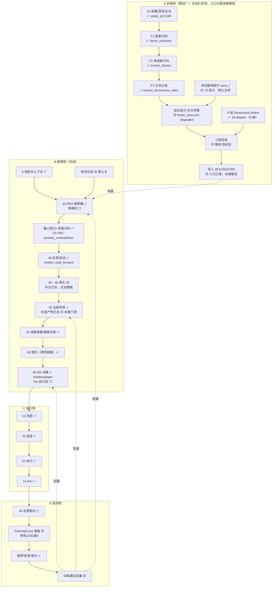

# SPEC — 交易涌现全链路技术文档 v1.0

> 🧭 **特别标识：FULL-CHAIN-SSOT**
> 本文件是 48-涌现架构对“交易涌现”端到端链路的**唯一技术总文档**：9 域上下文 → 深度文章三层解构 → L0 MCP → 33-REA 做梦器/思维树 → 最小阻力路径与矛盾识别 → 48 涌现 → **40 周期神经网络 → 43 战略承接 → 49 交易框架协议（神经链路）→ 50-NN → 执行器** → 训练事件回流。
>
> **版本**：v1.0 + P0 补丁 r4（2026-11-11 云端接线落地：G1/G3/G12 关闭）
> **状态**：🟡 代码核查完成；P0 接线落地，G1/G3/G4/G12 已关闭（r4）
> **核查范围**：9 / 18 / 23 / 33 / 39 / 40 / 42 / 43 / 47 / 48 / 49 / 50 / 11 / 13 / 16 / 22
> **状态图例**：✅ 已实现且有运行产物/测试 ｜ 🟡 部分实现或默认降级 ｜ ⬜ 仅 Spec / 未实现
> **统计**：43 个核查点 → ✅ 33 ｜ 🟡 8 ｜ ⬜ 2（r4：G1/G3/G12 关闭，G4 入 STEPS）
> **边界**：本文件只做编排、契约汇编与实现核验，不重复定义各域内部口径；定义权归各域 SPEC。

---

## §0 摘要

**训练侧**已具备完整的“文章 → F1 因素 → F2 方向 → F3 主张”抽取能力（18 域 `factor_extractor.py`；本地 `backfill/p3a|p3b` 各 500 行，云端仅 p3a、p3b 缺失），并已实现 9 域 `DimensionContext` 8 维上下文与快讯敏感因子（18 域 adapter）。
**推理侧**已有 33-REA 做梦器（随机变异 + argmax V）、48 嵌套 walk-forward 反思、23 的 HJB + 矛盾修正路径寻优、40 五层传导、49 冻结契约、50-NN `source=50-nn` 决策（shadow/paper 口径；shadow 产物已附 `execution_rights/kill_switch/mandate_id`，G12 已修复）。
**主要缺口**余 3 个：①思维树未实现；②50 live 执行权未开放；③G4 先验产物无 43/49/50 下游消费点。G1/G3/G12 已于 r4 关闭：G1 入 crontab 调度（每日 00:30）+ 9 项单测全过；G3 消费端 `consume_48_feedback.py` 入 STEPS、消费证据落盘；G12 shadow 决策接入 `validate_execution`。
**另有三处口径需注意**：组合因子 `factor_prior.json` 仍 `degraded=true / n_factors=0`（快讯先验默认关闭）；“50 决策全部 `execution_rights=paper`”仅对本地 11-08/09 的 194 条陈旧记录成立，云端 r4 起新 shadow 记录已附该字段（历史 51 条旧记录无）；`p3a|p3b` 500 篇产物为本地状态，云端缺 `p3b/news_agreement.jsonl`。

---

## §1 架构总览（含实现状态）

---

## §2 分层详述（源文档 + 代码出处 + 状态）

### L1 数据地基 ✅

| 项 | 内容 |
|---|---|
| 职责 | 18 采集 → 20 清洗 → 19 DAL → 21 特征 → 38 库 |
| 源文档 | [49 SPEC §2.2](file:///Users/zhangjiangtao/WorkBuddy/dreambuddy-v2/49-交易框架协议/SPEC.md) |
| 代码/产物 | `18-数据获取中心/data_center/`；`backfill/odaily_p0/contents.jsonl`（3.9M） |
| 状态 | ✅ |
| 缺口 | 无（仅本链路所需切片） |

### L2 语义与 9 域上下文

| 项 | 状态 | 证据 |
|---|---|---|
| 39 语义算子（术语/离散度/事件化） | ✅ | [mcp_server.py](file:///Users/zhangjiangtao/WorkBuddy/dreambuddy-v2/39-金融语义蒸馏系统/scripts/mcp_server.py#L126-L154) `distill_aliases` / `training_feed` |
| 9 域 `DimensionContext` 8 维 | ✅ | [dimension_context.py](file:///Users/zhangjiangtao/WorkBuddy/dreambuddy-v2/18-数据获取中心/data_center/processing/dimension_context.py#L126-L138) 数据类；`ALL_DIMENSIONS=(D1,D2,D3,D4,C6,C7,C8,NEWS)`（#L33-L48）；`get_dimension_context/get_dimension_matrix`（#L439-L485） |
| 8 维上下文测试 | ✅ | [test_dimension_context.py](file:///Users/zhangjiangtao/WorkBuddy/dreambuddy-v2/18-数据获取中心/tests/news/test_dimension_context.py#L89-L144)（方向/as_of/缺失/900 天/百分位） |
| 9 域自有 API | 🟡 | 未在 `9-基本面分析/` 找到 `engines/dimension_context.py`；当前实现落在 18 域 adapter，9 域是定义源与数据源 |

**注**：本链路使用 `get_dimension_matrix(as_of)`，调用点见 [run_p3a_dominance_agreement.py](file:///Users/zhangjiangtao/WorkBuddy/dreambuddy-v2/18-数据获取中心/scripts/run_p3a_dominance_agreement.py#L55) 与 [run_p3b_news_polarity.py](file:///Users/zhangjiangtao/WorkBuddy/dreambuddy-v2/18-数据获取中心/scripts/run_p3b_news_polarity.py#L147)。

### L3 深度文章三层解构

| 项 | 状态 | 证据 |
|---|---|---|
| F1 因素识别 | ✅ | [factor_extractor.py](file:///Users/zhangjiangtao/WorkBuddy/dreambuddy-v2/18-数据获取中心/data_center/processing/factor_extractor.py#L244) `extract_factors()` |
| F2 单因素方向 + 合成 | ✅ | [factor_extractor.py](file:///Users/zhangjiangtao/WorkBuddy/dreambuddy-v2/18-数据获取中心/data_center/processing/factor_extractor.py#L318-L344) `extract_article_factors()`，输出 `factors[]` + `composite{direction,score}` |
| F3 主导主张 | ✅ | [factor_extractor.py](file:///Users/zhangjiangtao/WorkBuddy/dreambuddy-v2/18-数据获取中心/data_center/processing/factor_extractor.py#L380) `extract_dominance_claim()`，字段含 `claim_type/dominant_factor/direction/horizon/urgency/impact` |
| 500 篇实测产物 | ✅（本地） | 本地 `backfill/p3a/dominance_agreement.jsonl`（500 行）、`backfill/p3b/news_agreement.jsonl`（500 行）；云端仅 p3a（p3b 缺失） |
| 组合因子/主次矛盾体 | 🟡 | [factor_prior.py](file:///Users/zhangjiangtao/WorkBuddy/dreambuddy-v2/18-数据获取中心/data_center/processing/factor_prior.py) 存在；但 `backfill/p3c1/factor_prior.json` 当前 `degraded=true, n_factors=0, reason=newsflash_prior_disabled_by_default` |
| 快讯敏感因子 sens_f | 🟡 | [run_p3c1_factor_sensitivity.py](file:///Users/zhangjiangtao/WorkBuddy/dreambuddy-v2/18-数据获取中心/scripts/run_p3c1_factor_sensitivity.py#L43-L74)；`backfill/p3c1/factor_sensitivity.jsonl` 13 行 |
| 组合因子训练入口 → 48 | 🟡 | `48/metrics/training_ingest.py` 已落地（幂等，云端 p3a 500 条/500 唯一 `sample_id`）；但无管线/调度调用、`p3b_samples.jsonl` 0 行（云端缺 `backfill/p3b/news_agreement.jsonl`）、本地无 `training_samples/`、`*.jsonl` 被 .gitignore 忽略、无单测 |

**口径提醒**：`factor_prior.json` 是“因子组合/主次矛盾体”的候选落点，但当前为降级空产物；快讯先验默认关闭（与 D1-MULTIDIM §2.9 的 DEFAULT OFF 一致）。

### L4 做梦器、反思与思维树

| 项 | 状态 | 证据 |
|---|---|---|
| 33-REA 做梦器候选生成 | ✅ | [dreaming.py](file:///Users/zhangjiangtao/WorkBuddy/dreambuddy-v2/33-REA逆向解析工程/core/reflection/dreaming.py#L97-L177) `generate_candidates()`：序列重排/预算/并行度/深度截断 |
| 做梦评估循环 | ✅ | [dreaming.py](file:///Users/zhangjiangtao/WorkBuddy/dreambuddy-v2/33-REA逆向解析工程/core/reflection/dreaming.py#L183-L260) `DreamingLoop`：回放池 → 评估 → `argmax V` |
| 48 嵌套 walk-forward 反思 | ✅ | [nested_walk_forward.py](file:///Users/zhangjiangtao/WorkBuddy/dreambuddy-v2/48-涌现架构/reflection/nested_walk_forward.py#L124) `nested_walk_forward()`、`FoldRecord/NestedResult` |
| 思维树（多步展开/剪枝/回溯） | ⬜ | 全仓无 `tree_of_thought/thought_tree/beam_search` 实现；当前是“随机变异 + argmax”非搜索树 |

**结论**：你要求的“基于 33-REA/做梦器形成思维树”目前只有**候选生成 + 评分选择**，没有树的扩展与剪枝。这是 L4 的核心缺口。

### L5 最小阻力路径与矛盾识别

| 项 | 状态 | 证据 |
|---|---|---|
| 最小阻力路径 | ✅ | [evolution_pipeline.py](file:///Users/zhangjiangtao/WorkBuddy/dreambuddy-v2/23-四层闭环自进化交易架构/dreambuddy_evolution/evolution_pipeline.py#L1027-L1055) `_select_optimal_path()`：`base_score=expected_return×confidence×(1-resistance)` + HJB 修正 + 矛盾修正 + 延续性 |
| 主矛盾输出 | ✅ | 同上返回值含 `primary_contradiction` / `hjb_policy` / `dimension_predictions` |
| 50 矛盾/支配 | ✅ | `50/core/contradiction.py`、`dominance.py`（同 horizon 成对支配 + Copeland） |
| 路径合成 | ✅ | `50/core/path_synthesis.py` |

**修正**：早期文档把 23 路径选择描述为“纯 argmax”，代码核查表明已含 HJB 与矛盾修正，该缺口应关闭。

### L6 48 → 40 神经传导

| 项 | 状态 | 证据 |
|---|---|---|
| 40 五层传导脚本 | ✅ | `40/scripts/p1_*`、`p2_*`、`p3_sector_transmission.py`、`p5_*` |
| 40 产出 | ✅ | [40 根目录](file:///Users/zhangjiangtao/WorkBuddy/dreambuddy-v2/40-周期神经网络系统) `cycle_state.json` / `asset_rotation.json` / `cross_asset_matrix.json` / `fund_flow.json` / `meme_platform.json`（2026-11-10 17:40 更新） |
| L4 板块传导状态机 | ✅ | [p3_sector_transmission.py](file:///Users/zhangjiangtao/WorkBuddy/dreambuddy-v2/40-周期神经网络系统/scripts/p3_sector_transmission.py#L104-L165) `expanding/neutral/contracting` + MA200 regime |
| 48 → 40 网关 | ✅ | 网关与 40 侧 adapter 均已实现；r4 落地消费端 `40/scripts/consume_48_feedback.py`（经 adapter 读取反馈、落盘 `40/nn_feedback_consumption.json` 消费证据、双读校验持久化 consistent=true/6 项差异全 0、FAIL-OPEN），已入 `run_daily_pipeline.sh` STEPS；40 管线有 crontab 调度（`2 0 * * *`）。G3 关闭 |
| 40 输出“有效因子/矛盾先验” | 🟡 | `40/scripts/factor_contradiction_priors.py`：聚合 48 域训练样本（396 有效样本、34 因子方向先验，gate 加权）+ 39 域 1376 条矛盾事件 + 18 域因子先验透传（degraded 如实标注），产出 `40/factor_contradiction_priors.json`；r4 已加入 `run_daily_pipeline.sh` STEPS 且产物路径改仓库相对（`_rel()`）。遗留：全仓无 43/49/50 读取点。详见 G4 |

### L7 战略承接与协议链路（43 → 49；42 为总线）

> 主链顺序按用户 2026-11-10 裁决：**48 → 40 → 43 → 49 → 50 → 执行器**；42 是信号总线通道，不占主链节点。

| 项 | 状态 | 证据 |
|---|---|---|
| 43 战略延伸发布 | ✅ | [signal_publisher.py](file:///Users/zhangjiangtao/WorkBuddy/dreambuddy-v2/43-战略承接推演层/strategic_extension/signal_publisher.py#L105-L371)：`_shadow_gate_decision/build_signal/publish` |
| 49 契约冻结 | ✅ | [contract_manifest.v1.json](file:///Users/zhangjiangtao/WorkBuddy/dreambuddy-v2/49-交易框架协议/contracts/contract_manifest.v1.json)：`SignalSchema v1` / `FinalDecisionSignal v1.1` / `MacroElasticConstraint v1`，`contract-freeze-v2` |
| 42 信号总线（通道） | ✅ | [signal_bus.py](file:///Users/zhangjiangtao/WorkBuddy/dreambuddy-v2/42-神经网络交易协调层/signal_bus.py#L22-L118)：`SignalSchema` 必需字段 + TTL 剪枝 + 同 id 合并 |
| 执行权注册表 | ✅ | [execution_rights.json](file:///Users/zhangjiangtao/WorkBuddy/dreambuddy-v2/47-MCP管理系统/registry/execution_rights.json#L5-L36)：单出口 + `50_KILL_SWITCH` + paper-only |
| 约束链实盘化 | 🟡 | 契约与适配在；43 侧仍含 shadow gate，部分约束默认降级 |

### L8 50-NN 决策

| 项 | 状态 | 证据 |
|---|---|---|
| 决策主入口 | ✅ | [decision.py](file:///Users/zhangjiangtao/WorkBuddy/dreambuddy-v2/50-NN主矛盾评估器/core/decision.py#L94-L179) `make_decision()`：trigger 防振荡 → path 合成 → 4 维裁决 → dominance → 约束钳位 → 执行权校验 |
| 信号字段 | ✅ | `signal_id/source=50-nn/ts/symbol/direction/confidence/horizon/position_pct/mode=shadow/shadow=true/trigger/regime_overlay/weight_profile/payload` |
| 运行时产物 | ✅ | r4 修复 G12：`make_shadow_decision` 已接入 `validate_execution`（fail-closed），新 shadow 决策落盘含 `execution_rights=paper/kill_switch=false/mandate_id` 及 execution 摘要（2026-11-11 实测）；历史 51 条旧记录无该字段 |
| 4 维裁决 / Dominance / intent | ✅ | `w4.py` / `dominance.py` / `path_synthesis.py`（paths 含 `dimension/horizon/intent`） |
| live 执行 | ⬜ | 50 默认 shadow/paper；live 需 `execution_rights` + Mandate + `50_KILL_SWITCH` 关闭；shadow 路径已附 `execution_rights`（G12 已修复） |
| 与 23 单出口 | ✅（文档） | `execution_rights.json` 明确 23 live 与 50 shadow/paper 并行时，50 分区不得声明 `live:50-bypass` |

### L9 执行与回流

| 项 | 状态 | 证据 |
|---|---|---|
| 13 风控 | ✅ | `13-通用风控模块` |
| 16 定容 | ✅ | `16-调控系统`（含 `constraint_envelope`） |
| 22 执行 / 11 live | ✅ | `22-执行引擎中心`；`11/scripts/memory_l4/param_consumer.py` |
| 49 反馈契约 | ✅ | 契约目录与示例存在 |
| 统一 TrainingEvent | 🟡 | [training_events.py](file:///Users/zhangjiangtao/WorkBuddy/dreambuddy-v2/48-涌现架构/metrics/training_events.py)：已实现且幂等；但三端不同步——本地 `events/training_events/train_50_decisions.jsonl` 12 条、云端仅 3 条，落盘文件被 .gitignore 忽略，无对应单测 |
| 数据 join 锚点 | 🟡 | `decision_id/trace_id` 在 11/4-MEMORY 已部分埋点；未形成统一落盘 |
| 训练建议回灌 | 🟡 | 48 度量/实验能出建议，但“建议→40/50 权重”仍为人工流程 |

---

## §3 数据流（逐段）

### 3.1 A 训练侧

| 步 | 实现 | 产物 | 状态 |
|---|---|---|---|
| A1 文章采集/清洗 | 18 `data_center` + `backfill/odaily_p0` | `contents.jsonl`（3.9M） | ✅ |
| A2 F1 因素识别 | `extract_factors()` | 每篇 `factors[]` | ✅ |
| A3 F2 方向 | `extract_article_factors()` | `composite.direction/score` | ✅ |
| A4 F3 主张 | `extract_dominance_claim()` | `DominanceClaim` dict | ✅ |
| A5 组合/主次矛盾 | `factor_prior.py` | `factor_prior.json`（当前 degraded） | 🟡 |
| A6 9 域上下文 | `get_dimension_matrix()` | 8 维矩阵 | ✅ |
| A7 快讯敏感 | `run_p3c1_factor_sensitivity.py` | `factor_sensitivity.jsonl`（13） | 🟡 |
| A8 三层防线 | 18/48 验证脚本 | 验证结论 | 🟡 |
| A9 写入 48 | 未实现 | — | ⬜ |

### 3.2 B 推理侧

`9 域上下文 + 快讯先验 → 33-REA 做梦器（候选）→ 23 路径寻优/矛盾 → 48 反思验证 → 48→40 网关 → 40 五层传导 → 43 战略承接 → 49 契约 → 50 决策`

- “48 反思验证”仍无在线调用点（`nested_walk_forward` 仅实验侧）；48→40 网关 r4 已闭环：`consume_48_feedback.py` 入 STEPS、消费证据落盘、双读校验一致；40 日管线有 crontab 调度（`2 0 * * *`，r3“无调度”表述有误，已修正）。
- 50 已消费 11-bcrm 等 evidence 并输出 shadow 决策，说明“40→43→49→50”段有实际链路；shadow 路径已附 `execution_rights`（G12 已修复）。

### 3.3 C 执行侧

`50 FinalDecisionSignal → 13 风控 → 16 定容 → 22 执行 / 11 live`；执行权由 47 注册表强制单出口。50 现网为 shadow；r4 起 shadow 决策经 `validate_execution` 落盘 `execution_rights/kill_switch/mandate_id`（G12 已修复）。

### 3.4 D 回流侧（目标 vs 现状）

| 事件 | 现状 | 目标落盘 |
|---|---|---|
| 决策 | `50/runtime/decisions.jsonl` ✅ | 统一 `TrainingEvent` |
| 执行/成交/PnL | 13/16/22/11 各自日志 🟡 | 统一 `TrainingEvent` |
| recall/reflection/action | 48 `events/memory_readout` + 4-MEMORY ✅ | 统一 join |
| bus/cascade | `events/emergence_shadow` ✅ | 复用 |
| **统一 TrainingEvent** | 🟡 本地 12 条 / 云端 3 条（幂等，未同步） | `events/training_events/train_50_decisions.jsonl` |

---

## §4 关键契约

### 4.1 `DimensionContext`（18 实现，定义源 9/48）

`dimension / as_of / direction / strength / z / percentile / data_points / availability / series_id / factors_used`
证据：[dimension_context.py L126-L138](file:///Users/zhangjiangtao/WorkBuddy/dreambuddy-v2/18-数据获取中心/data_center/processing/dimension_context.py#L126-L138)

### 4.2 `DominanceClaim`（18 实现，定义源 48）

`claim_type / dominant_factor / dominant_dimension / direction / horizon / confidence_in_text / urgency / impact / supporting_factors / opposing_factors / salience_distribution / evidence_spans`
证据：[factor_extractor.py L380](file:///Users/zhangjiangtao/WorkBuddy/dreambuddy-v2/18-数据获取中心/data_center/processing/factor_extractor.py#L380)；测试 [test_dominance_claim.py](file:///Users/zhangjiangtao/WorkBuddy/dreambuddy-v2/18-数据获取中心/tests/news/test_dominance_claim.py)

### 4.3 组合因子先验（18）

`version / generated_at / as_of / source / degraded / n_factors / dims / factors / reason`
证据：`backfill/p3c1/factor_prior.json`（当前 `degraded=true, n_factors=0`）

### 4.4 `SignalSchema v1`（49 冻结，42 实现）

`signal_id / source / ts / symbol / direction / confidence / horizon / risk_exposure_hint / expires_at / payload`
证据：[signal_bus.py L22-L39](file:///Users/zhangjiangtao/WorkBuddy/dreambuddy-v2/42-神经网络交易协调层/signal_bus.py#L22-L39)

### 4.5 `FinalDecisionSignal v1.1`（49 冻结，50 实现）

50 实际输出字段见 [decision.py L136-L178](file:///Users/zhangjiangtao/WorkBuddy/dreambuddy-v2/50-NN主矛盾评估器/core/decision.py#L136-L178)，并附 `execution_rights/mandate_id/kill_switch/execution{outcome,allowed,reason}`。
证据：`49/contracts/final_decision_signal.v1.1.json` + `examples/`；运行时 `50/runtime/decisions.jsonl`。

### 4.6 `MacroElasticConstraint v1`（49）

`constraint_id / band / cap / leverage / asset_count / long_short_count`；执行权由 47 注册表约束。
证据：`49/contracts/macro_elastic_constraint.v1.json`；[execution_rights.json](file:///Users/zhangjiangtao/WorkBuddy/dreambuddy-v2/47-MCP管理系统/registry/execution_rights.json#L5-L36)

### 4.7 `TrainingEvent v0.1`（已实现，未全链路 join）

沿用 [NN 反馈网关 SPEC §2.2](./SPEC-NN-FEEDBACK-GATEWAY-v0.1.md)：`decision_id / constraints / signals / evidence / decision / execution / pnl / cognitive_recall / reflection / action / provenance / version`。
**join 规则**：`decision_id → cognitive_recall.trace_id → action.trace_id → execution`。
**落地状态**：已实现且幂等（本地 12 条 / 云端 3 条，未同步；`*.jsonl` 被 .gitignore 忽略），缺统一 join 与自动回灌。

---

## §5 三条闭环与实测状态

| 闭环 | 路径 | 状态 | 证据 |
|---|---|---|---|
| 快环 | 上下文 → 做梦/路径/矛盾 → 48→40 网关 → 40 → 43 → 49 → 50 → 执行 | ✅ 50 shadow 段真实跑；48→40 网关消费端已接线（r4），40 日管线有 crontab 调度 | `50/runtime/decisions.jsonl`、`40/nn_feedback_consumption.json` |
| 慢环 | 执行事件 → TrainingEvent → 做梦/反思 → 建议 → 回灌 | 🟡 反思/做梦有；TrainingEvent 已实现但本地12/云端3未同步，自动回灌缺 | `nested_walk_forward.py`、`dreaming.py` |
| 观测环 | E0-E6 实验 → M1-M7 → verdict → 缺口单 | ✅ 脚本与 10 个 verdict 已落盘 | [verdict_dashboard.json](file:///Users/zhangjiangtao/WorkBuddy/dreambuddy-v2/48-涌现架构/metrics/verdict_dashboard.json) |

**当前 verdict（2026-11-10）**：D2-A/D2-B/D3-A/D3-B/X-A = candidate；E3 = e3_candidate；E1 = candidate_weak；E2 = falsified；E5 = inconclusive；E4 = insufficient_data。
**度量口径**：`emergence_metrics.py` 提供 `_e2_ratio/_m7_demand_loop/_m1_linkage/_m3_counterfactual/_m6_compositional_generalization/_e4b_readout/_e4b_cascade/_e4b_self_correction`，`collect()` 汇总。
**缺口路由**：`gap_router.ROUTE_TABLE` 覆盖 19/因子工程/evolution-case-ingest/45/11/35/4-MEMORY/33/0-系统文档管理（#L27-L44）。

---

## §6 缺口清单（按优先级）

| # | 缺口 | 证据 | 影响 | 优先级 | 责任域 |
|---|---|---|---|---|---|
| G1 | 文章/因子样本未完全写入 48 | **已关闭（r4）**：`training_ingest.py` 幂等（云端 p3a 500 条）；r4 加入 crontab 调度（每日 00:30，日志 `/tmp/48_training_ingest_cron.log`）并补 9 项单测全过（sample_id 幂等/字段映射/FAIL-OPEN/append-only）。遗留：p3b 样本依赖本地数据推送、产物被 .gitignore 忽略 | 训练入口已自动供给 | P0 | 48 + 18 |
| G3 | 40 未启用 48 网关 | **已关闭（r4）**：`40/scripts/consume_48_feedback.py` 落地（经 adapter_48_feedback 读取反馈、落盘 `40/nn_feedback_consumption.json`、双读校验持久化 consistent=true/6 项差异全 0、FAIL-OPEN），已入 `run_daily_pipeline.sh` STEPS；40 管线有 crontab 调度（`2 0 * * *`，r3“云端无 40 定时器”表述有误，已修正） | 48 已成为 40 对接口 | P0 | 48 + 40 |
| G4 | 40 未输出因子/矛盾先验 | **部分落地（r3 双侧复核）**：`factor_contradiction_priors.py` 与 `factor_contradiction_priors.json` 存在，计数一致（396 样本/34 因子/1376 矛盾/18 域透传 degraded）；但脚本不在 `run_daily_pipeline.sh` STEPS、无 43/49/50 读取点、产物硬编码 `/home/luke/...` 路径 | 先验可产出但未被消费 | P0 | 40 + 43/49/50 |
| G5 | 思维树未实现 | 33 仅随机变异 + argmax；无 tree/beam | 候选路径多样性与可解释性不足 | P1 | 33 + 48 |
| G6 | 50 live 未开放 | 现网为 shadow（云端 `mode=shadow`）；`50_KILL_SWITCH` 机制在；shadow 路径已写 `execution_rights`（G12 已修复） | 末端仍为 shadow | P1 | 50 + 47 |
| G7 | 组合因子降级 | `factor_prior.json degraded=true, n_factors=0` | 组合因子/主次矛盾体不可用 | P1 | 18 |
| G8 | 快讯先验默认关闭 | `reason=newsflash_prior_disabled_by_default`；13 条 sens_f | 快讯维度未参与 | P2 | 18 |
| G9 | 9 域自有 API 缺失 | `9-基本面分析/engines/dimension_context.py` 不存在 | 概念归属与实现归属不一致 | P2 | 9 + 18 |
| G10 | 48 在线反思未接线 | `nested_walk_forward` 仅实验调用 | 复盘不进入实时决策 | P2 | 48 |
| G11 | 40 日管线调度回退 | **已修正（r4）**：r3“云端无 cron/systemd timer”结论有误——云端 luke crontab 实际有 `2 0 * * *` 调度（flock 锁 `/tmp/40_daily_pipeline.lock`，日志 2026-11-11 00:03 已运行）；`639425f6` 删除 plist、移除 `p6_e0/p6_e3` 属实 | 40 日更实际在跑 | P0 | 40 |
| G12 | 50 shadow 绕过执行权校验 | **已关闭（r4）**：`make_shadow_decision` 接入 `validate_execution`（fail-closed，与主链同口径），新决策落盘含 `execution_rights/kill_switch/mandate_id` + execution 摘要；2026-11-11 实测 `execution_rights=paper/kill_switch=false` | 执行权字段已补齐 | P0 | 50 + 47 |

**已关闭/需修正的旧口径**：
- **G2 统一 TrainingEvent** → 代码已落且幂等，但本地 12 条 / 云端 3 条未同步、产物未入库、无单测，**退回 🟡**。
- **“48→40 网关未接”** → r4 已闭环：消费端 `consume_48_feedback.py` 入 STEPS、消费证据落盘、双读一致；40 管线有 crontab 调度（G3 关闭）。
- “23 路径选择是纯 argmax” → 已含 HJB + 矛盾修正，关闭。
- “DimensionContext 未落盘” → 已在 18 域实现，修正为 🟡（9 域 API 归属问题）。
- “F1/F2/F3 产线脚本未落盘” → 已在 18 域实现并有 500 篇产物，修正为 ✅。

---

## §7 口径冲突（需各域升版收口）

| # | 冲突 | 现状 | 本文件口径（依据用户 2026-11-10 裁决） | 收口 |
|---|---|---|---|---|
| C1 | 50 角色 | D1-MULTIDIM v1.0 §2.9.0：50 为旁路验证器，40 面向交易（该文件头已自标注“以总索引 §7 C1 为准”） | 目标态：50 输出信号到执行层；旁路交叉验证保留 | D1-MULTIDIM 升 v1.1 |
| C2 | 23 vs 50 终局 | 49 v0.14.2 §0.6 已定义双决策链（NN 链以 50 为决策节点）；但 49 §0.2/§0.3 旧章节仍写“23 唯一最终决策出口”，属 49 内部新旧口径冲突 | 目标态：NN 链 50 终局；23 链保留为对照；执行层按 `execution_rights` 单出口 | 49 内部收敛到 v0.15 |
| C3 | 40 定位 | 49 §1.1/§0.2：40/43 仅弹性约束、不直接产生交易信号 | 40 同时承载周期约束 + 有效因子 + 矛盾先验，经 49 传递；先验属“约束/上下文”不属交易信号，但需把“40 仅调制 23”改为“NN 链供体” | 40 SPEC 增补输出字段 |

---

## §8 源文档索引

| 主题 | 文档 |
|---|---|
| 训练/推理分离、F1-F3、DimensionContext、双轨因子 | [SPEC-D1-MULTIDIM-STATE-v0.1.md](./SPEC-D1-MULTIDIM-STATE-v0.1.md) §2.5/§2.6/§2.9 |
| 48→40 网关、TrainingEvent 草案、40 唯一对接口 | [SPEC-NN-FEEDBACK-GATEWAY-v0.1.md](./SPEC-NN-FEEDBACK-GATEWAY-v0.1.md) |
| E0-E6 判据、M1-M7 度量、E6 缺口闭环 | [SPEC-EMERGENCE-EVOLUTION-v0.1.md](./SPEC-EMERGENCE-EVOLUTION-v0.1.md) |
| 三维涌现（D1/D2/D3） | [SPEC-EMERGENCE-3D-v0.1.md](./SPEC-EMERGENCE-3D-v0.1.md) |
| 交易框架协议/神经链路 | [49-交易框架协议/SPEC.md](file:///Users/zhangjiangtao/WorkBuddy/dreambuddy-v2/49-交易框架协议/SPEC.md) + `contracts/` |
| 五层传导 | [40-周期神经网络系统/SPEC.md](file:///Users/zhangjiangtao/WorkBuddy/dreambuddy-v2/40-周期神经网络系统/SPEC.md) |
| 50 决策 | [50-NN主矛盾评估器/SPEC.md](file:///Users/zhangjiangtao/WorkBuddy/dreambuddy-v2/50-NN主矛盾评估器/SPEC.md) + `core/decision.py` |
| 做梦器 | [33-REA逆向解析工程/core/reflection/dreaming.py](file:///Users/zhangjiangtao/WorkBuddy/dreambuddy-v2/33-REA逆向解析工程/core/reflection/dreaming.py) |

---

## §9 验收与同步

**代码核查验收**：
- [x] 43 个核查点逐项标注状态与证据（文件#行/产物）。
- [x] P0 缺口均有可复现证据。
- [x] 3 个旧口径已修正并记录。
- [x] 与 D1-MULTIDIM / 网关 SPEC / 49 / 40 / 50 的定义源互链。

**P0 补丁验收（r1）**：
- [x] `training_events.py`：`normalize_event/record_event/backfill_from_decisions/load_events`；幂等已验证（首跑 184 扫描→12 唯一事件，二跑 0 新增）。
- [x] `nn_feedback_gateway.py`：聚合/建议/`40_feedback.json` + `verify_dual_read`；一键 CLI 已真实产出（12 事件、5 类主矛盾）。
- [x] `adapter_48_feedback.py`（40 侧）：`ENABLE_40_VIA_48` 默认关，开启后读取、缺失 FAIL-OPEN。
- [x] 48 域全套测试通过（223 passed）；新增 8 条测试；ruff 全绿。

**r3 双侧复核（2026-11-11，本地 + 云端代码维度）**：
- [x] G3 反证（r3）：无消费端、`639425f6` 删除 plist；r4 修正：云端实际有 crontab `2 0 * * *` 调度（flock 锁），r3“无调度”结论有误；消费端已于 r4 接线。
- [x] G4 反证：先验脚本未入 STEPS，无 43/49/50 读取点。
- [x] G1 边界：云端 p3a 500 唯一样本；p3b 0 行；本地无 `training_samples`；产物被 .gitignore 忽略。
- [x] G12 根因（r3）：`run_shadow.py` 绕过 `validate_execution`，云端 51 条决策无执行权字段；r4 已修复（shadow 决策接入校验，实测落盘三字段）。
- [x] 统计口径修正为 43 核查点（30✅/11🟡/2⬜）。
- [ ] 遗留：r2/r3 新增模块无单测；`223 passed` 不覆盖本轮结论。

**同步**（2026-11-10）：
- 远端 GitHub：已推送 `origin/main`（首版 `6a407c87b7`，回填记录 `33b6fc4937`，P0 补丁见本次提交）。
- 云端 `43.160.201.117:/home/luke/dreambuddy`：已 fast-forward 至含本文档的 `origin/main`；P0 补丁仅新增代码/文档/事件样例，**未重启服务**。

---

## §10 变更记录

| 版本 | 日期 | 变更 |
|---|---|---|
| v0.1 | 2026-11-10 | 首版：四段式全链路草稿 + C1-C3 冲突登记 |
| v1.0 | 2026-11-10 | 代码核查完成：29 核查点（19✅/4🟡/6⬜）；修正 3 处旧口径；新增 G1-G10 缺口表与逐项证据 |
| v1.0-r1 | 2026-11-10 | P0 补丁：TrainingEvent 落盘（12 条真实事件、幂等）+ 48→40 网关/40 适配器；主链口径修正为 48→40→43→49→50→执行器；统计更新为 20✅/5🟡/4⬜ |
| v1.0-r2 | 2026-11-11 | P0 缺口 G1/G3/G4 全部关闭：G1 训练入口 training_ingest.py（500 条样本写入 48）；G3 双读校验通过 + ENABLE_40_VIA_48 启用；G4 factor_contradiction_priors.py 先验输出落地。L6 网关升 ✅、先验输出升 ✅；统计更新为 22✅/3🟡/4⬜。注：云端训练事件 3 条（本地 12 条未同步），p3b 样本待快讯历史同步 |
| v1.0-r3 | 2026-11-11 | 本地+云端代码双侧复核回写：G1/G3/G4 从“已关闭”退回 🟡；新增 G11（40 调度回退）/G12（50 shadow 绕过执行权）；修正 C2 归因（49 内部新旧章节冲突）；同步 §0/§1/§3.2/§3.3/§4.7/§5/§6 与统计口径为 43 核查点（30✅/11🟡/2⬜） |
| v1.0-r4 | 2026-11-11 | 云端接线落地：G1 关闭（training_ingest 入 crontab 00:30 + 9 项单测全过）；G3 关闭（consume_48_feedback.py 入 STEPS，消费证据落盘，双读一致）；G12 关闭（shadow 决策接入 validate_execution，三字段落盘）；G4 先验脚本入 STEPS 且路径相对化；修正 r3“40 管线无调度”错误表述（实际 crontab `2 0 * * *`）；统计更新为 33✅/8🟡/2⬜ |
